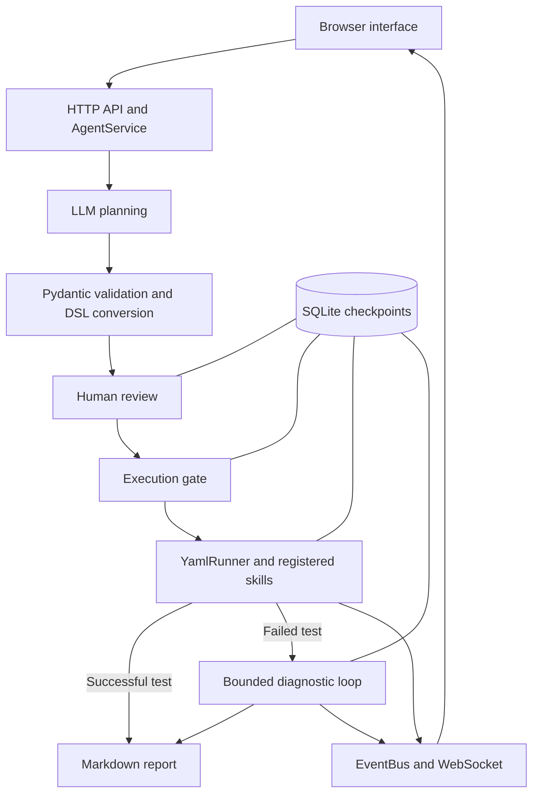

# AutoTestAgent

LLM-assisted device testing with human approval, persistent LangGraph workflows, and bounded failure diagnosis.

AutoTestAgent turns device knowledge and test requirements into structured test plans. Plans are validated, reviewed by a person, and executed through registered skills. When a test fails, a diagnostic agent gathers additional evidence through restricted tools before generating a report.

This repository provides a **virtual-device prototype**. Interactive planning, diagnosis, and reporting require a configured model endpoint; automated tests use fake models and isolated temporary data.

## Key capabilities

- **Validated plans:** Pydantic checks model-generated JSON intents and manually edited YAML/DSL plans. The converter checks registered skill names. The planner allows one model repair attempt after an invalid response.
- **Approval tied to plan content:** each approval records a revision and SHA-256 digest. Editing steps or runtime parameters invalidates the approval.
- **Persistent workflows:** LangGraph and SQLite checkpoints preserve task state, review history, execution results, and diagnostic evidence.
- **Conservative recovery:** interrupted execution is marked as uncertain. Diagnosis and report generation can resume separately, without automatically replaying device execution.
- **Bounded diagnosis:** a model can request checks from a separate diagnostic tool allowlist, subject to time, round, and tool-attempt budgets. Findings must cite existing evidence IDs.
- **Live feedback:** HTTP APIs and WebSocket events support a browser interface for plan editing, review, progress, diagnostic evidence, and Markdown reports.

## Architecture



LangGraph manages the task lifecycle. The existing `YamlRunner` interprets device-test steps, including groups, loops, conditions, variables, timers, and failure handling. Review and execution start are separate persistent waiting points.

Models return JSON through a Chat Completions-compatible API. Schemas are included in prompts and validated locally; native model function calling is not required.

## Quick start

Requirements: **Python 3.11+** and a Chat Completions-compatible model endpoint for interactive use. The included device skills simulate operations and do not require physical hardware.

### Windows PowerShell

```powershell
py -3.11 -m venv .venv-win
.\.venv-win\Scripts\python.exe -m pip install -r requirements-runtime.txt
Copy-Item config.example.yaml config.yaml
```

### Linux / macOS

```bash
python3 -m venv .venv
.venv/bin/python -m pip install -r requirements-runtime.txt
cp config.example.yaml config.yaml
```

Edit `config.yaml` to set the model endpoint, model name, and any required API key:

```yaml
llm:
  base_url: "http://127.0.0.1:8000/v1"
  model: "your-model"
  api_key: "EMPTY"
```

`EMPTY` is a placeholder for endpoints that do not require a key. Keep your actual configuration local; `config.yaml` is ignored by Git. The example configuration selects the `virtual_device` skill group and binds the application to loopback.

Start the application using the environment you created:

```powershell
# Windows PowerShell
.\.venv-win\Scripts\python.exe main.py
```

```bash
# Linux / macOS
.venv/bin/python main.py
```

Open <http://127.0.0.1:8080>. The default WebSocket port is `8081`; the frontend reads the configured port automatically.

## Example workflow

1. Start with the included virtual-device knowledge, upload a Markdown knowledge document, or import a plan.
2. Generate a plan from your requirements. The planner validates the JSON intent and converts it into an editable DSL plan.
3. Inspect the steps and runtime parameters, then approve or reject the current revision.
4. Start the approved test. Changing the plan or its parameters requires a new approval.
5. Follow module progress and logs. Failed tests enter diagnosis, where the model can request checks and produce findings with evidence references.
6. Read the report. If report generation fails, retry that stage using the saved execution results. Task records remain available after refreshing the page or restarting the service.

The web interface currently uses Chinese labels. The approval and start actions are labeled `通过审核` and `开始测试`.

## Diagnostic tools and limits

| Tool | Scope |
|---|---|
| `read_failure_details` | Read a saved failure record by its ID. |
| `read_execution_log` | Read a bounded tail of captured execution messages and outputs. |
| `check_tcp_port` | Connect to a literal IP from an approved plan variable, on an allowed port, without sending application data. |
| `list_serial_ports` | Enumerate local serial ports without opening them or sending commands. |

Diagnostic tools are separate from the device skill registry. The diagnostic agent cannot use that registry to restart devices, change parameters, or rerun tests.

Default limits are **4 model decision rounds, 3 tool-request attempts, and 90 seconds**. Blocked requests also consume the tool-attempt budget. Repeated checks are blocked, and model errors or exhausted budgets produce a cautious fallback conclusion while preserving the original test results.

Evidence sent to the diagnostic model is length-limited and redacted for common sensitive fields, IPv4 addresses, and connection URLs. Evidence-ID validation checks that citations exist; the proposed cause still requires human verification.

## Tests

Install development dependencies with the Python environment created above:

```powershell
# Windows PowerShell
.\.venv-win\Scripts\python.exe -m pip install -r requirements-dev.txt
.\.venv-win\Scripts\python.exe -m pytest -m "not browser"
```

```bash
# Linux / macOS
.venv/bin/python -m pip install -r requirements-dev.txt
.venv/bin/python -m pytest -m "not browser"
```

The suite covers intent and DSL validation, stale approvals, workflow persistence, recovery boundaries, report retries, duplicate-start protection, HTTP APIs, diagnostic budgets, tool restrictions, evidence references, and model timeout isolation.

Browser tests cover desktop and mobile interactions. On Windows, the suite can use a local Chrome installation. Otherwise, install Playwright Chromium using the same Python environment:

```bash
python -m playwright install chromium
python -m pytest
```

In these two commands, replace `python` with `.\.venv-win\Scripts\python.exe` on Windows or `.venv/bin/python` on Linux/macOS if the environment is not activated.

**Latest local verification (November 1, 2026):** 44 non-browser tests passed; 6 browser cases were deselected. The checks used fake models, mock skills, temporary SQLite databases, and local loopback services. This result verifies the tested application behavior; real-model quality and physical-device operation have not been evaluated in this snapshot.

## Code map

| Path | Responsibility |
|---|---|
| `engine/intent_schema.py` | Recursive intent and DSL contracts. |
| `engine/planner.py`, `engine/intent_converter.py` | Model planning, validation feedback, and intent conversion. |
| `engine/workflow.py` | Lifecycle graph, approvals, checkpoints, and recovery. |
| `engine/diagnostician.py`, `engine/diagnostic_tools.py` | Diagnostic decisions, budgets, evidence, and restricted tools. |
| `engine/yaml_runner.py`, `engine/skill_registry.py` | DSL execution and skill discovery. |
| `engine/agent_service.py` | Task operations and worker coordination. |
| `server/`, `web/` | HTTP, WebSocket events, and the browser interface. |
| `skills/common/`, `skills/virtual_device/` | Prompt templates, simulated skills, and example knowledge. |
| `tests/` | Unit and integration checks. |

Each device skill exports `skill_class` from `skill.py` and inherits `BaseSkill`. Its `skill.md` describes its capabilities for planning. Runtime plans, reports, and SQLite state are created locally and excluded from version control.

The backend uses Python's standard-library HTTP server; the frontend uses plain HTML, CSS, and JavaScript. Additional libraries include LangGraph, `langchain-core` for `StructuredTool`, Pydantic, PyYAML, `simpleeval`, and `websockets`. Dependency ranges are recorded in `requirements-runtime.txt` and `requirements-dev.txt`.

See the [API reference](docs/API.md) for task endpoints.

## Current scope

- The service runs one device task at a time and has no user authentication, tenant isolation, or skill sandbox.
- Recovery works at lifecycle stages. It does not resume individual DSL steps or guarantee exactly-once device operations.
- The included device actions are simulations. Physical-device adapters and original device knowledge are excluded from this snapshot.
- Diagnostic findings are suggestions for human investigation. Their real-world accuracy has not been benchmarked.

Source history and the scope of this snapshot are recorded in [Source provenance](docs/PROVENANCE.md).
